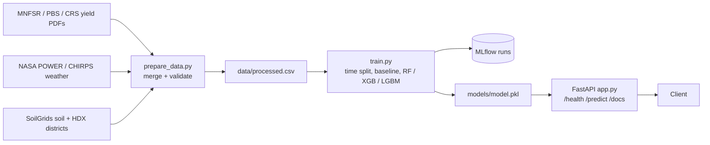

# District-Level Crop Yield Prediction for Pakistan Under Climate-Driven Data Drift

## Pitch
Crop yield models for Pakistan are trained once and assume the future climate resembles the past. Floods and heatwaves (2010, 2022) break that assumption, so static models degrade exactly when accuracy matters most. We build an MLOps system that predicts district-level yield (t/ha) for wheat, cotton, rice and sugarcane, and (in M2) retrains itself when climate-driven drift is detected.

## Architecture



## Quick start

```
git clone https://github.com/Anis29017/crop-yield-mlops.git
cd crop-yieldmlops
python3 -m venv venv
source venv/bin/activate            # Windows: venv\Scripts\activate
pip install -r requirements.txt
```

### Data steps (download + build features; run once, in this order)

| # | Command | Output |
|---|---------|--------|
| 1 | `python -m src.fetch_districts` | `data/interim/districts.gpkg`, `district_points.csv` (134 districts, HDX boundaries) |
| 2 | `python -m src.fetch_nasa_power` | `data/interim/power_daily.csv` (daily temperature, humidity, sunlight 1981-2025) |
| 3 | `python -m src.fetch_chirps` | `data/interim/chirps_monthly.csv` (monthly rainfall 1981-2025) |
| 4 | `python -m src.fetch_soilgrids` | `data/interim/soil_features.csv` (0-30 cm soil, real pixels only) |
| 5 | `python -m src.build_climate_features` | `data/interim/climate_features.csv` (per-season features) |

Rain comes only from CHIRPS: NASA POWER's PRECTOTCORR jumps from 2020 onwards
(all-district mean ~1,250 mm vs ~400 mm before) and would look like drift in the test years.

### Model steps (one command)

```
python -m src.run_pipeline          # 6 yield labels -> 7 merge -> 8 prepare -> 9 train -> tests
mlflow ui                           # http://127.0.0.1:5000
uvicorn src.app:app --reload        # http://127.0.0.1:8000/docs
```

Or step by step: `python -m src.build_yield_labels`, `python -m src.build_master`,
`python -m src.prepare_data`, `python -m src.train`, `pytest -q`.

## Data
One row per district x crop x year (134 districts, wheat / rice / cotton / sugarcane, 1981-2025).
Target: `yield_t_ha` = production / area.

- **Yields:** `data/raw/Pakistan_Master_Yield_1981-2025.xlsx`, compiled by hand from PBS (1981-2009),
  provincial Crop Reporting Service / Development Statistics books (2009-2020) and MNFSR (2020-2025).
  Every source error found is documented in its Notes sheet.
- **Weather:** NASA POWER daily (temperature, humidity, sunlight); **rain:** CHIRPS v2.0 monthly.
- **Soil:** ISRIC SoilGrids 2.0, 0-30 cm, district mean of real pixels.
- **Districts:** OCHA/HDX Pakistan boundaries (2022), matched to the yield data's districts by
  `data/raw/district_name_table.csv`.

Split by year (never at random, so the model never sees the future):
train <= 2017, validate 2018-2020 (used to choose the model), test 2021-2023 (held out; the chosen model is scored once).

Features: season weather (mean max temperature, days above 40C, rain, rain vs normal), soil (pH, organic carbon,
clay, sand, nitrogen), crop, province, year, and the district's yields in exactly 1, 2 and 3 years before
(+ their trend). Rows without all three previous years are dropped.

Task: predict this season's yield (t/ha). The model learns the change from the average of the previous
3 years (`src/model.py`), because yields change slowly and drift upwards, and tree models cannot predict
outside the range they were trained on. It must beat two naive baselines: last year's yield and the 3-year average.

## MLflow best run

11 runs in experiment `crop-yield-m1`: 2 naive baselines + 9 models (RandomForest / XGBoost / LightGBM,
from cautious to flexible settings). Score = average over the 4 crops of (RMSE for that crop / mean yield of
that crop), i.e. the typical error as a share of a crop's normal yield; lower is better.

| | Value |
|---|---|
| Run ID | `c98c304b60824ca9beac0468871e6b58` (registered as `crop-yield-model` version 1) |
| Model | LightGBM, predicting the change from the 3-year average yield |
| Hyperparameters | `n_estimators=300, num_leaves=7, learning_rate=0.03, min_child_samples=100, reg_lambda=5, subsample=0.8, colsample_bytree=0.8` |
| Validation score (2018-2020) | **0.150** |
| Baselines (validation): last year / 3-year average | 0.161 / 0.159 |
| Held-out test score (2021-2023) | **0.202** (baselines: last year 0.243, 3-year average 0.196) |
| Validation RMSE per crop (t/ha) | wheat 0.280, rice 0.241, cotton 0.168, sugarcane 6.78 |
| Validation R2 / MAE (pooled) | 0.980 / 1.39 t/ha |
| Saved model | `models/model_v1_lightgbm.pkl` (+ `models/model.pkl`, the copy the API loads) |

**Why this run:** it has the lowest validation score of the 9 model runs, and it beats both naive baselines
(about 6% better than the 3-year average and 7% better than last year's yield). The cautious settings
(few leaves, large minimum leaf size, regularisation) won; the most flexible XGBoost and LightGBM runs scored
0.164-0.170, worse than the baselines, because year-to-year yield change is mostly noise and flexible trees fit it.

**On the held-out test years** the model clearly beats last year's yield (0.202 vs 0.243) but is slightly behind
the 3-year average (0.202 vs 0.196). 2021-2023 includes the 2022 floods: a model trained on calmer years loses its
edge when the climate shifts. This is the drift that Milestone 2 addresses by monitoring and retraining.

## Tests

```
pytest -q
```
Offline unit tests (no internet): data preparation and validation (`tests/test_app.py`,
`tests/test_data_steps.py`), the weather/soil feature code (`tests/test_climate_data.py`),
model wrapper and model loading, and the API (`/health`, `/predict` valid and invalid input).
The two tests that load the trained model are skipped until `python -m src.train` has been run.

## Repository layout
```
src/fetch_districts.py         1  district boundaries + query points (HDX)
src/fetch_nasa_power.py        2  daily weather (NASA POWER)
src/fetch_chirps.py            3  monthly rainfall (CHIRPS via IRI)
src/fetch_soilgrids.py         4  soil (SoilGrids)
src/build_climate_features.py  5  per-season weather features
src/build_yield_labels.py      6  yields + district_id
src/build_master.py            7  merge yields + weather + soil + previous-year yield
src/prepare_data.py            8  cleaning + validation -> data/processed.csv
src/model.py                      model wrapper (predicts change from the 3-year average)
src/train.py                   9  training + MLflow logging + test evaluation + model registry
src/app.py                     10 FastAPI service (/health, /predict)
src/run_pipeline.py            runs 6-9 and the tests
tests/                         unit tests (offline)
```

## Team
See [CONTRIBUTION.md](CONTRIBUTION.md).
