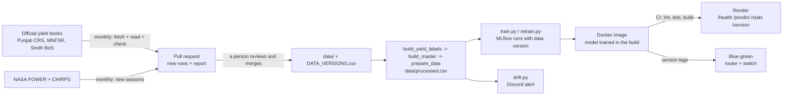

# District-Level Crop Yield Prediction for Pakistan Under Climate-Driven Data Drift

## Pitch
Crop yield models for Pakistan are trained once and assume the future climate resembles the past. Floods and
heatwaves (2010, 2022) break that assumption, so static models degrade exactly when accuracy matters most.
We predict district-level yield (t/ha) for wheat, cotton, rice and sugarcane, and run it as a service that
collects each new year of official data itself, checks it, notices climate drift, retrains, and releases new
versions safely.

## Architecture



## Live service

**https://crop-yield-api-hy6r.onrender.com** (opens the interactive API docs)

Hosted on Render (free web service, Singapore), built from this repository's `Dockerfile`. The free service
sleeps after 15 minutes without traffic: the first request then takes about a minute.

| Endpoint | What it returns |
|---|---|
| `GET /health` | `{"status": "ok"}` (used by Render and the Docker healthcheck) |
| `POST /predict` | Predicted yield (t/ha) for one district, crop and year |
| `GET /stats` | Request count, average / p95 / max latency per endpoint, model prediction time |
| `GET /version` | Which model is serving and which data version and code commit it was trained on |
| `GET /docs` | Interactive docs (`/` redirects here) |

### cURL examples

```bash
URL=https://crop-yield-api-hy6r.onrender.com

curl $URL/health

curl -X POST $URL/predict -H "Content-Type: application/json" -d '{
  "district": "Faisalabad", "province": "Punjab", "crop": "wheat", "year": 2025,
  "season_tmax_mean": 29.57, "season_rain_mm": 63.93, "heat_days_40c": 22, "rain_anomaly": -19.59,
  "soil_ph": 8.02, "soil_oc": 7.18, "soil_clay": 20.99, "soil_sand": 34.26, "soil_nitrogen": 0.73,
  "prev_yield": 3.764, "prev2_yield": 3.659, "prev3_yield": 3.276}'

curl $URL/stats
curl $URL/version
```

Expected: `{"status":"ok"}`, a `predicted_yield_t_ha` of about 3.65, `/stats` counting the requests, and
`/version` showing the data version (the last line of `data/DATA_VERSIONS.csv`) and the code commit.
On Windows use `curl.exe`; in cmd, write the JSON on one line with `\"` inside, or use the `/docs` page.

## Run with Docker (one command)

```bash
docker build -t crop-yield:v1 . && docker run -p 8000:8000 crop-yield:v1
```

Then open http://localhost:8000/docs. The model is not in the repository: the image trains it during the build
from the real data files in `data/` (about 4 minutes). Docker reports the container `(healthy)` once `/health`
answers (`docker ps`).

The image uses **Python 3.12** (`python:3.12-slim`), not 3.11: `xgboost==3.4.1` in `requirements.txt` needs 3.12,
and CI uses the same version.

## Deployment (Render)

1. Render -> **New -> Web Service** -> connect the GitHub repository, branch `main`.
2. Runtime **Docker** (Render builds the `Dockerfile`), instance type **Free**, region Singapore.
3. Health check path **`/health`**.
4. **Auto-Deploy: After CI Checks Pass**, so only commits that passed lint, tests and the Docker build go live.
5. Deploy. Render builds the image (which trains the model), starts it, and moves traffic to it only after
   `/health` answers; the previous version keeps serving until then.

Redeploy and rollback (Render and local image tags) are in [RUNBOOK.md](RUNBOOK.md).

**Build time: 64 minutes -> 4 minutes.** The first Render build took over an hour: XGBoost and LightGBM start one
thread per CPU they see, and on Render's shared build machine those threads fought over a small CPU share. The
Dockerfile sets `OMP_NUM_THREADS=1` (and `LOKY_MAX_CPU_COUNT=1`); one thread gives exactly the same scores on this
data, and the build now takes about 4 minutes.

## CI (GitHub Actions)

`.github/workflows/ci.yml` runs on every push to `main` and every pull request:

| Job | What it does |
|---|---|
| lint | `ruff check src/ tests/` |
| test | builds the training data from the real files, trains the model, runs `pytest` (the model must exist) |
| build | only if lint and test pass: builds the Docker image, waits for `(healthy)`, calls `/health`, `/predict`, `/stats` and `/version` in the container |

Every change reaches `main` through a pull request with green CI.

## Monitoring and latency

A middleware in `src/app.py` times every request, logs it with its latency (Render -> Logs, or `docker logs`)
and adds an `X-Latency-ms` header. `/stats` shows the request count and average latency overall and per endpoint
(with p95 and max) and the model's own prediction time. Counters reset when the app restarts.

Training also logs prediction speed to MLflow for every model run (`latency_single_row_ms`: one row, like one API
request; `latency_ms_per_1k_rows`; `fit_seconds`). Speed is reported, not used to choose the model.

| Model | One row (`latency_single_row_ms`) |
|---|---|
| LightGBM (chosen) | about 1.3 ms |
| XGBoost | about 1.1 ms |
| Random Forest | about 27 ms |
| Baselines (last year / 3-year average) | 0.03 / 0.19 ms |

Random Forest is about 20x slower than LightGBM, because it starts a pool of threads for every prediction
(`n_jobs=-1`). Times depend on the machine; the ranking does not.

## Project Focus: keeping the model current under climate-driven drift

**What it is.** Our focus is to keep the model correct as new seasons and new climate arrive, with a person
approving every change. It has four connected parts: **DataOps** (collect and check each new year of data
automatically), **retraining** (rebuild the model on the new data and keep it only if it is better),
**drift detection** (notice when the climate moves away from the training years and alert us) and **blue-green
release** (put a new version live in one checked step, with an instant way back).

**Why it suits this project.** Yields are published once a year by three government sources (Punjab Crop
Reporting Service, MNFSR, Sindh Bureau of Statistics) as PDF books, one of them scanned. In M1 we copied them by
hand; every new year would mean doing that again. And the model already shows the problem we are built for: on the
held-out 2021-2023 years, which include the 2022 floods, it loses its edge over the 3-year average (see below).
A model that is not updated, and not watched, gets worse exactly when the climate shifts.

**What we built (M2).**

| Part | What it does | Where |
|---|---|---|
| Collect | Monthly GitHub Actions workflow checks the three official pages, downloads only new books (checked: real PDF, fingerprint recorded) | `src/dataops/fetch.py`, `sources.py`, `.github/workflows/fetch-sources.yml`, `data/sources/manifest.csv` |
| Read | Three readers turn each book into rows: MNFSR tables, Punjab CRS (two layouts) and the scanned Sindh book (OCR) | `src/dataops/read_mnfsr.py`, `read_punjab.py`, `read_sindh.py`, `read_books.py` |
| Check | Every book: districts must add up to the printed division / province totals (exactly, for OCR), row totals must equal their parts, every district name must be known. Every row: 9 validation rules stop the pipeline (`validate_yields.py`); 2 more warn | `src/dataops/*`, `src/validate_yields.py` |
| Approve | Rows of a book that passed every check go into a pull request with a report of all checks; nothing is used until a person merges it | `data/sources/new_yields/`, `src/build_yield_labels.py` |
| Climate | Each month the newest finished seasons are added from NASA POWER and CHIRPS (only the new months are downloaded) | `src/update_climate.py` |
| Data versions | Every change of the training data gets a version (fingerprint of `data/processed.csv`), listed in `data/DATA_VERSIONS.csv`; every MLflow run and `/version` record which data and code a model was trained on | `src/data_version.py` |
| Drift | KS tests compare the climate and yield features of new years with the training years; a Discord alert is sent when they differ | `src/drift.py` |
| Retrain | Retrains on the new data (moving the train / validation / test years forward) and promotes the new model only if its validation score is better; runs once a year (1 May, after the wheat statistics) or on demand | `src/retrain.py`, `.github/workflows/retrain.yml` |
| Release | Blue-green: two version-tagged images run side by side behind a router; a switch moves all traffic only after the new version passes `/health` and a real `/predict`; rollback is one step | `src/router.py`, `src/blue_green.py`, `deploy/blue-green/` |

Merging a data pull request also redeploys the Render service, whose Docker build retrains the model on the new
data.

**Tested on real books.** Every Punjab book from 2020-21 on reads with all checks passing and matches our
hand-checked M1 data; the MNFSR 2022-23, 2023-24 and 2024-25 books match it outside Punjab (where M1 used the
Punjab CRS books); the scanned Sindh book reads with
22 of 24 year columns adding up exactly (the one misread column is left out automatically). The checks also caught
real errors printed in the books (e.g. Wazirabad rice 2024-25 printed as 1156.7 instead of 157.8). Blue-green was
run with Docker (v2 and v3 images): switch, rollback, and a refused switch to a stopped version. Under a steady
stream of requests (router and both colours as plain processes), 1,197 requests during a switch and a rollback
gave 0 errors.

**Known limits (to complete for the final presentation).** A book with a new layout or a failed check gets no
rows: it is fixed in its reader or entered by hand. MNFSR's site does not answer GitHub's servers, so its new
books are checked from a machine in Pakistan (RUNBOOK). The drift check is not yet run on each newly arrived
year automatically. Blue-green runs with Docker on any machine; the public Render service stays a single service
(Render itself switches traffic only after `/health` passes).

**How we will demonstrate it.**
1. The "Fetch source data" workflow: a run, its pull request and the report of every check.
2. A book read on screen: its Excel with the totals check, and a book held back by a failed check.
3. `data/DATA_VERSIONS.csv`, the MLflow run with its data version, and `/version` on the live service.
4. A drift check on 2022 and the Discord alert.
5. Retraining with the promotion gate (promoted or rejected).
6. Blue-green: `status`, `switch green` with the `X-Deploy-Color` header changing, `rollback`.

## Run locally without Docker

```
git clone https://github.com/Anis29017/crop-yieldmlops.git
cd crop-yieldmlops
python3 -m venv venv
source venv/bin/activate            # Windows: venv\Scripts\activate
pip install -r requirements.txt
```

### Data steps (download + build features; run once, in this order)

| # | Command | Output |
|---|---------|--------|
| 1 | `python -m src.fetch_districts` | `data/interim/districts.gpkg`, `district_points.csv` (134 districts, HDX boundaries) |
| 2 | `python -m src.fetch_nasa_power` | `data/interim/power_daily.csv` (daily temperature, humidity, sunlight 1981-2025) |
| 3 | `python -m src.fetch_chirps` | `data/interim/chirps_monthly.csv` (monthly rainfall 1981-2025) |
| 4 | `python -m src.fetch_soilgrids` | `data/interim/soil_features.csv` (0-30 cm soil, real pixels only) |
| 5 | `python -m src.build_climate_features` | `data/interim/climate_features.csv` (per-season features) |

Rain comes only from CHIRPS: NASA POWER's PRECTOTCORR jumps from 2020 onwards
(all-district mean ~1,250 mm vs ~400 mm before) and would look like drift in the test years.

### Model steps (one command)

```
python -m src.run_pipeline          # 6 yield labels -> 7 merge -> 8 prepare -> 9 train -> tests
mlflow ui                           # http://127.0.0.1:5000
uvicorn src.app:app --reload        # http://127.0.0.1:8000/docs
```

Or step by step: `python -m src.build_yield_labels`, `python -m src.build_master`,
`python -m src.prepare_data`, `python -m src.train`, `pytest -q`.

## Data
One row per district x crop x year (134 districts, wheat / rice / cotton / sugarcane, 1981-2025).
Target: `yield_t_ha` = production / area.

- **Yields:** `data/raw/Pakistan_Master_Yield_1981-2025.xlsx`, compiled by hand from PBS (1981-2009),
  provincial Crop Reporting Service / Development Statistics books (2009-2020) and MNFSR (2020-2025).
  Every source error found is documented in its Notes sheet.
- **Weather:** NASA POWER daily (temperature, humidity, sunlight); **rain:** CHIRPS v2.0 monthly.
- **Soil:** ISRIC SoilGrids 2.0, 0-30 cm, district mean of real pixels.
- **Districts:** OCHA/HDX Pakistan boundaries (2022), matched to the yield data's districts by
  `data/raw/district_name_table.csv`.

Split by year (never at random, so the model never sees the future):
train <= 2017, validate 2018-2020 (used to choose the model), test 2021-2023 (held out; the chosen model is scored once).

Features: season weather (mean max temperature, days above 40C, rain, rain vs normal), soil (pH, organic carbon,
clay, sand, nitrogen), crop, province, year, and the district's yields in exactly 1, 2 and 3 years before
(+ their trend). Rows without all three previous years are dropped.

Task: predict this season's yield (t/ha). The model learns the change from the average of the previous
3 years (`src/model.py`), because yields change slowly and drift upwards, and tree models cannot predict
outside the range they were trained on. It must beat two naive baselines: last year's yield and the 3-year average.

## MLflow best run

11 runs in experiment `crop-yield-m1`: 2 naive baselines + 9 models (RandomForest / XGBoost / LightGBM,
from cautious to flexible settings). Score = average over the 4 crops of (RMSE for that crop / mean yield of
that crop), i.e. the typical error as a share of a crop's normal yield; lower is better.

| | Value |
|---|---|
| Run ID | `c98c304b60824ca9beac0468871e6b58` (registered as `crop-yield-model` version 1) |
| Model | LightGBM, predicting the change from the 3-year average yield |
| Hyperparameters | `n_estimators=300, num_leaves=7, learning_rate=0.03, min_child_samples=100, reg_lambda=5, subsample=0.8, colsample_bytree=0.8` |
| Validation score (2018-2020) | **0.150** |
| Baselines (validation): last year / 3-year average | 0.161 / 0.159 |
| Held-out test score (2021-2023) | **0.202** (baselines: last year 0.243, 3-year average 0.196) |
| Validation RMSE per crop (t/ha) | wheat 0.280, rice 0.241, cotton 0.168, sugarcane 6.78 |
| Validation R2 / MAE (pooled) | 0.980 / 1.39 t/ha |
| Saved model | `models/model_v1_lightgbm.pkl` (+ `models/model.pkl`, the copy the API loads) |

**Why this run:** it has the lowest validation score of the 9 model runs, and it beats both naive baselines
(about 6% better than the 3-year average and 7% better than last year's yield). The cautious settings
(few leaves, large minimum leaf size, regularisation) won; the most flexible XGBoost and LightGBM runs scored
0.164-0.170, worse than the baselines, because year-to-year yield change is mostly noise and flexible trees fit it.

**On the held-out test years** the model clearly beats last year's yield (0.202 vs 0.243) but is slightly behind
the 3-year average (0.202 vs 0.196). 2021-2023 includes the 2022 floods: a model trained on calmer years loses its
edge when the climate shifts. This is the drift that Milestone 2 addresses by monitoring and retraining.

## Tests

```
ruff check src tests
pytest -q
```
Offline tests (no internet): data steps and validation, weather / soil features, the yield-book readers (on rows
copied from the real books), the fetcher (fake pages built from the real ones), new-book rows, climate update,
data versioning, drift and retraining, blue-green router and switch, and the API (`/health`, `/predict`, `/stats`,
`/version`). Tests that need the trained model are skipped until `python -m src.train` has run (CI runs them).
Full-book tests run when the PDFs are given (`MNFSR_TEST_PDF`, `PUNJAB_TEST_RABI`, `PUNJAB_TEST_KHARIF`,
`SINDH_TEST_PDF`).

## Repository layout
```
src/fetch_districts.py         1  district boundaries + query points (HDX)
src/fetch_nasa_power.py        2  daily weather (NASA POWER)
src/fetch_chirps.py            3  monthly rainfall (CHIRPS via IRI)
src/fetch_soilgrids.py         4  soil (SoilGrids)
src/build_climate_features.py  5  per-season weather features
src/build_yield_labels.py      6  yields (workbook + approved new books) + district_id, validated
src/build_master.py            7  merge yields + weather + soil + previous-year yield
src/prepare_data.py            8  cleaning + validation -> data/processed.csv
src/model.py                      model wrapper (predicts change from the 3-year average)
src/train.py                   9  training + MLflow logging (with data version) + model registry
src/app.py                     10 FastAPI service (/health, /predict, /stats, /version)
src/run_pipeline.py            runs 6-9 and the tests
src/validate_yields.py         yield validation rules (DataOps)
src/dataops/                   fetch new books, read them (MNFSR, Punjab CRS, Sindh OCR) (DataOps)
src/update_climate.py          add the newest finished seasons to the climate table (DataOps)
src/data_version.py            data versions (DATA_VERSIONS.csv, MLflow, /version)
src/drift.py                   drift check + Discord alert
src/retrain.py                 retraining with a promotion gate
src/router.py, src/blue_green.py  blue-green router and switch
deploy/blue-green/             docker compose for blue-green + its steps
data/sources/                  manifest of known books, approved new-book rows
data/DATA_VERSIONS.csv         one line per data version
.github/workflows/             ci.yml, fetch-sources.yml (monthly), retrain.yml (yearly)
tests/                         unit tests (offline)
```

## Team
See [CONTRIBUTION.md](CONTRIBUTION.md). AI use: [AI_USAGE.md](AI_USAGE.md).

